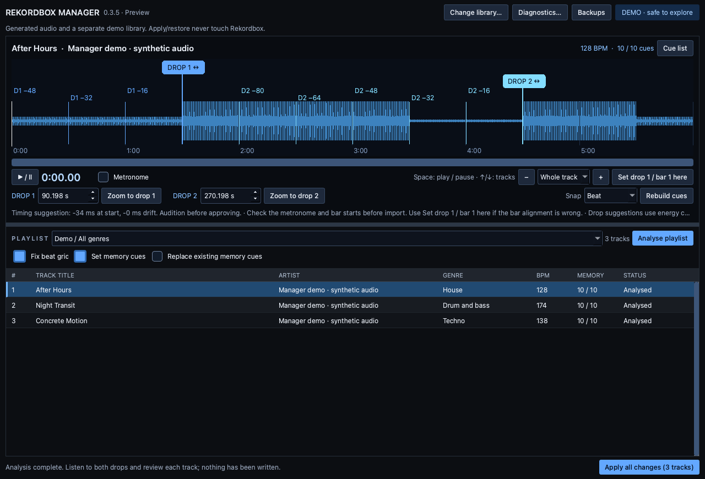

# Rekordbox Manager

Prepare Rekordbox playlists with beat-grid review, editable drop markers, and
memory cues every 16 bars before your drops. Preview changes with a waveform and
metronome, then import supported edits with automatic backups. All processing
runs locally on your computer.

## Download

**Preview 0.3.5 — no Python installation required.**

| Your computer | Download | Requirements |
| --- | --- | --- |
| Windows PC | [Download for Windows](https://github.com/wetenhall/rekordbox-manager/releases/download/v0.3.5/Rekordbox-Manager-0.3.5-Windows-x64.zip) | Windows 10/11, x64; analysis and preview only |
| Mac with Apple chip (M series) | [Download for Mac — Apple Silicon](https://github.com/wetenhall/rekordbox-manager/releases/download/v0.3.5/Rekordbox-Manager-0.3.5-macOS-Apple-Silicon.zip) | macOS 12.3 or later |
| Mac with Intel processor | [Download for Mac — Intel](https://github.com/wetenhall/rekordbox-manager/releases/download/v0.3.5/Rekordbox-Manager-0.3.5-macOS-Intel.zip) | macOS 12 or later |

[Release notes and checksums](https://github.com/wetenhall/rekordbox-manager/releases/tag/v0.3.5)
· [All releases](https://github.com/wetenhall/rekordbox-manager/releases)
· [Report a problem](https://github.com/wetenhall/rekordbox-manager/issues)

Choose **Apple menu → About This Mac** to check your Mac's chip/processor.
Download an app ZIP from the links above, rather than GitHub's source-code ZIP.
The releases are portable packages: extract the full download before opening it.

**Compatibility:** saving grids and cues is enabled only for **Rekordbox
7.2.19.0342 on macOS**, with supported local MP3/WAV tracks. Windows and other
Rekordbox versions remain **read-only**. Automatic drop suggestions need your
review. This is a preview, not a claim of general compatibility with every library.



*Preview with generated test audio; no personal library or commercial music is shown.*

## Built-in functions

### Library and playlist browsing

- Open an existing encrypted Rekordbox 6/7 `master.db` without an XML export.
- Detect the usual database location or choose a custom location manually.
- Load regular playlists with their parent-folder names and original track order.
- Display track title, artist, genre, BPM, duration, existing cues and analysis issues.
- Change the connected library from the workspace.
- Check for Rekordbox/background processes and pending database journals before access.
- Automatically keep unsupported installations read-only; smart playlists are excluded.

### Audio preview and waveform

- Play/pause local audio, seek by clicking the waveform, and use Space for transport.
- Switch tracks with Up/Down, wrapping through the playlist while preserving edits.
- Zoom up to 64× using buttons, the zoom menu or the mouse wheel, then pan horizontally.
- Compare the existing grey beat grid with the proposed blue grid.
- Audition a sample-aligned metronome with bar accents on the proposed grid.
- Resize the waveform/playlist areas using the draggable divider.

### Beat-grid review

- Analyse a playlist in the background with per-track results and errors.
- Suggest small beat-alignment and tempo-drift corrections from audio transients.
- Set the first drop as bar 1 manually, without changing the tempo.
- Analyse grids only, memory cues only, or both together.
- Recalculate cues and metronome timing after a grid change.
- Refuse unsupported grid writes, including variable tempo and out-of-bounds adjustments.

### Drop markers and memory cues

- Suggest first and second drops using changes in bass energy.
- Drag both drop markers, or edit their positions in seconds.
- Snap markers to beats, snap to bar starts, or turn snapping off.
- Zoom directly to either drop; prevent the two markers from crossing.
- Rebuild countdown cues every 64 beats (16 bars in 4/4) before the drops.
- Retain manual anchors and flag edits that still need a cue rebuild.
- Budget up to ten memory points/loops and flag short intros, tight drop gaps or lack of slots.
- Keep existing memory cues by default, or explicitly replace ordinary memory cues.
- Preserve hot cues and saved loops; review the proposed cue list before import.

### Import, backups and recovery

- Import reviewed playlist grids and/or memory cues with one batch confirmation
  on the verified macOS/Rekordbox combination.
- Skip and list tracks with analysis errors or cues that still need rebuilding.
- Stage and validate changes before replacing the database and changed analysis files.
- Create timestamped backups with checksums and an operation manifest.
- Browse backups, choose a backup location and restore the connected library when safe.
- Refuse stale imports or restores that would overwrite newer library changes.
- Roll back caught installation failures and provide recovery for interrupted operations.
- Leave audio files unchanged and retain every backup until you remove it yourself.

### Diagnostics and privacy

- Export local diagnostics containing schema columns and aggregate counts, without
  track titles, audio paths or the database key.
- Process audio locally, with no telemetry, cloud processing or automatic uploads.
- Keep preview audio caches, backups and diagnostics on your computer.

See [cue rules](#cue-rules), [analysis limitations](#analysis-limitations), and
[backups and local data](#backups-and-local-data) for the exact boundaries.

## Current status: preview 0.3.5

**Direct beat-grid and memory-cue import is enabled for Rekordbox 7.2.19.0342 on macOS.**
The app reads regular playlists from the encrypted library. With **Fix beat grid**
enabled, it prepares small timing/drift corrections first, then generates memory
cues using that grid. One batch import saves both the grid and cues; there is no
manual XML workflow. Verified backups cover the database and changed analysis files.
Audio, existing hot cues and saved loops are preserved.

The writer supports constant-tempo 4/4 local MP3/WAV tracks at 44.1 or 48 kHz.
The detector cannot guarantee correct musical drops, bar starts or half/double-time.
Audition the metronome. Seek to the real first drop and use **Set drop 1 / bar 1 here**
when bar alignment is wrong, then **Rebuild cues**. This shifts the nearest beat to
that position and makes it beat 1 without changing tempo. Changing the grid invalidates
existing cue proposals until rebuilt. Variable-tempo grids, adjustments crossing audio
boundaries, shared/missing analysis files and unsupported formats are refused.
Streaming/cloud-synced records and inconsistent cue caches also remain unsupported.
Other Rekordbox versions and Windows remain read-only. Rekordbox **7.0.9.0007** has not been validated for writing.

Integration evidence on 7.2.19.0342: native memory-cue records were captured from
32-second generated WAV and VBR MP3 files. The Manager imported ten cues into each,
then Rekordbox was reopened and displayed their timestamps and labels. Its cue-call
controls recalled the imported eight-second cue on both formats. The cue caches
remained consistent after Rekordbox saved and quit. Personal track records and playlists were unchanged by the Manager import. Applying
and restoring a copy of the native encrypted database also restored its original
SHA-256 exactly. Hardware/USB export and other Rekordbox versions remain untested.

Grid verification used native timing and BPM edits to establish the file format.
Manager then imported a changed tempo, beat times and bar numbering, plus ten cues,
into both generated WAV and VBR MP3 tracks. Rekordbox showed 122 BPM and recalled the
first imported cue at bar 1, beat 1 on both. The grids survived Rekordbox saving and
closing. A private-copy import/restore reproduced the original database and all
changed analysis files byte-for-byte. This verifies serialization, not automatic
musical correctness on arbitrary tracks.

Internal automated checks use generated audio and a separate test library.
No commercial music is bundled.

## Install on Windows

1. Download the Windows ZIP and choose **Extract All**.
2. Keep the entire extracted `Rekordbox Manager` folder together, including `_internal`.
3. Open `Rekordbox Manager.exe`. This preview is unsigned, so Windows may show an
   unknown-publisher/SmartScreen prompt. Only proceed if you trust this repository
   and downloaded the release here; do not disable system protection globally.
4. Close Rekordbox, confirm you have a library backup, then select your `master.db`.
   A common Windows location is `%APPDATA%\Pioneer\rekordbox\master.db`.
5. Follow the playlist review steps below. **Import remains disabled on Windows.**

A successful Windows build and synthetic smoke test are not verification against
an actual Windows Rekordbox library. Report compatibility problems with your app,
Windows and Rekordbox versions; do not attach your library database or music.

## Install on Mac and review a playlist

1. Unzip the download for your Mac's processor and move `Rekordbox Manager.app` to Applications.
2. Open it and read the startup notice. The current build is ad-hoc signed for
   testing, not Developer ID signed/notarized. macOS may require approval in
   System Settings → Privacy & Security (or System Preferences → Security & Privacy on older macOS). Do not disable Gatekeeper globally.
3. On the first screen, confirm Rekordbox is closed and your library is backed up.
   Click **Choose database…**, select `master.db`, then **Connect and continue**.
   The playlist workspace opens only after the library and first playlist load.
   Use **Change library…** in the workspace to select a different database.
   The file chooser starts
   at a detected default location when available. Custom library locations can
   be selected manually. Common Mac location: `~/Library/Pioneer/rekordbox/`.
4. Choose a playlist below the waveform. **Fix beat grid** is enabled by default
   on a supported installation; keep **Set memory cues** enabled and analyse. Drag the divider between the deck and playlist to resize them. The
   Up/Down arrows switch tracks and update the preview, wrapping at the ends
   (except while editing time fields or using menus); Backups is in the top toolbar.
5. Press **Space** to play/pause the selected track (except while editing a text
   or time field). Click the waveform to seek. Use **+ / −**, the zoom menu or scroll over the
   waveform to zoom up to 64×. Use the horizontal scrollbar to pan. The existing
   grid is grey and the proposed grid is blue. Enable Metronome for sample-aligned
   clicks on the proposed grid.
6. Drag the **DROP 1** and **DROP 2** handles to adjust the anchors; they snap to
   beats by default and cannot cross each other. Choose **Snap: Bar** for bar starts,
   or **Snap: Off** for precise placement between beats. Rebuilding keeps your chosen
   positions and flags anchors that are not on bar starts; moving a marker does not
   change the grid. If the grid bar starts are wrong,
   seek to the actual first drop and click **Set drop 1 / bar 1 here** first. **Zoom to drop 1 / 2** centres the
   view on that marker for precise placement. Seconds fields remain available.
   The **Rebuild cues** button turns amber and says **needed** after a drop edit.
   Click it to update the 16-bar countdown markers, then review the
   cue list. Moving an anchor requires rebuilding its cues and preserves the edit
   when switching between tracks. Reopening the app requires fresh analysis.
7. After checking and editing the playlist, click **Import grids + cues to Rekordbox**
   to save your changes. One final
   confirmation covers the batch; there are no per-track approval controls.
   Tracks with analysis errors or cues awaiting a rebuild are explicitly listed
   and skipped. The confirmation shows the backup location. Keep Rekordbox closed
   until the import succeeds, then reopen it to see the saved cues. Unsupported
   file formats or inconsistent database records stop the whole import before
   the original database is replaced.

Use **Diagnostics…** after connecting a real library to save a local report
of schema columns and aggregate counts. It omits music titles, audio paths and
the database key. This is useful for the next compatibility-testing step.

Import modifies the library only after the final confirmation. Reading, analysis
and marker editing remain read-only.

## Cue rules

- Automatic drop suggestions snap to bar downbeats. Manually rebuilt cues preserve
  the exact selected anchors, including their fractional beat offset.
- Count backwards in 64-beat steps (16 bars in 4/4), using actual grid timestamps
  so tempo changes are respected.
- Reserve both drops and, where possible, 48 bars before the second drop.
- Add the first-drop countdown towards the start; use remaining slots to extend
  the second countdown without crossing the first drop.
- Limit memory points plus saved memory loops to ten. Never force a marker at
  file start if it does not fit the countdown pattern.
- Preserve hot cues and all loops. Keep existing memory cues by default; the
  explicit Replace option replaces ordinary memory cues only.
- Flag insufficient slots, short gaps between drops, incomplete intros and
  invalid grids. Never silently exceed the slot budget.

## Analysis limitations

The current detector is a conservative signal-based prototype, **not a trained
music-structure model**. Drop suggestions compare bass-energy changes across
bars. They can identify builds, false drops or outros incorrectly. Manual anchor
review is required. Genres guide warnings, not hard tempo rules.

Grid analysis proposes small alignment/drift corrections where transients
support them. It does not automatically resolve half/double-time interpretations,
incorrect bar-one alignment, large tempo errors, or variable-tempo grids. Bar-one
alignment can be set manually at the first drop; larger/variable-tempo corrections
still need Rekordbox. Cues-only analysis never changes a grid.
Grid-only analysis never changes cue positions. Missing, silent, unsupported or
over-30-minute audio is reported per track.

Smart playlists are excluded rather than incorrectly treated as static playlists.
The reader refuses databases with outstanding journal data. If instructed, reopen
Rekordbox and quit it cleanly; never delete WAL/journal files to bypass the guard.
Cloud-sync write interactions are not supported. Writing is gated to the locally
verified Rekordbox version and local content records, not upstream compatibility claims.

## Backups and local data

Default data directories:

- macOS: `~/Library/Application Support/Rekordbox Manager/`
- Windows: `%LOCALAPPDATA%\Rekordbox Manager\`

Backups live in the `Backups` subdirectory. Change the location in the Backups
screen. Each timestamped backup contains original files and a manifest with
checksums, original paths, operation state, and expected post-operation hashes.
No backup is automatically deleted. Music files are never modified.

Memory-cue imports stage an encrypted database copy, update both `djmdCue` and
`contentCue`, advance the local update counter, and validate integrity and cue
read-back before replacing `master.db`. Backups include the original database,
plus every changed analysis file, but not audio or unchanged files. Grid writes
patch PQTZ, clear the secondary PQT2 cache like the native editor, and update BPM
metadata when needed. Other analysis tags and the .3EX embedding file stay unchanged. Source hashes, audio timestamps and
Rekordbox/agent process checks block stale or concurrent operations. Installation
uses a durable journal and rolls back caught failures when exclusive access can
still be established. Keep Rekordbox closed during the whole operation.

Restore is available in Backups for the same connected library. It refuses to
overwrite any newer database or analysis-file changes, including changes Rekordbox may save after
reopening. Recovery can release an interrupted Manager lock only after its process
has exited; then select the interrupted backup and restore it. A backup on the
same disk does not protect against disk failure. Process checks cannot eliminate
all races with external applications that do not honour the Manager's lock.

Metronome WAVs are rendered under `Preview audio`. They are local disposable
cache files and may be removed while Manager is closed. Backups and diagnostics
are not uploaded. There is no telemetry, cloud processing, or auto-updater.

## Development

Python 3.12, macOS 12+ on Intel / 12.3+ on Apple Silicon, or Windows 10/11 (64-bit). Build and test each architecture
separately. Development on Apple Silicon does not produce an Intel executable
unless an Intel Python and Intel dependencies are used.

```sh
python3 -m venv .venv
# macOS
source .venv/bin/activate
# Windows PowerShell: .venv\Scripts\Activate.ps1
python -m pip install -e '.[dev]'
python run.py
python -m pytest -q
python scripts/build.py
```

To prepare disposable audio for testing inside Rekordbox itself:

```sh
python scripts/prepare_rekordbox_test_audio.py
```

This writes three standard 44.1 kHz stereo PCM WAVs, a test playlist and a reference
manifest under `dist/Rekordbox Test Audio`. Import the test playlist into Rekordbox
and let its normal analysis finish. This is developer fixture setup; the Manager's
normal library connection does not require playlist exports/imports. These simple
signals are integration fixtures, not realistic benchmarks for the three genres.

For an Intel build on a newer macOS targeting Monterey, explicitly install the
older-platform NumPy/SciPy wheels before building (the versions also publish
macOS-14-only wheels, which pip otherwise prefers):

```sh
python -m pip download --dest build/monterey-wheels --platform macosx_12_0_x86_64 --only-binary=:all: --python-version 312 --implementation cp --no-deps numpy==2.2.6 scipy==1.15.3
python -m pip install --force-reinstall --no-deps --no-index --find-links build/monterey-wheels numpy==2.2.6 scipy==1.15.3
```

The build script audits embedded binaries and fails if any requires macOS newer
than the app declares: 12.0 on Intel or 12.3 on Apple Silicon. This is a compatibility check, not a substitute for testing on Monterey.

Set `REKORDBOX_MANAGER_DATA_DIR` to a disposable directory for UI/testing sessions.
The tests use generated audio, artificial ANLZ files, and plain/encrypted SQLite
fixtures; they do not access a personal Rekordbox library. GUI tests use Qt's
offscreen platform. Sandbox environments may need permission for Qt's CPU and
process queries.

The [GitHub Actions workflow](.github/workflows/build.yml) tests and builds Windows
x64, Intel Mac and Apple Silicon Mac separately. Each frozen executable must pass
the synthetic self-test (GUI, analysis, cue editing, demo import/restore, encrypted
database dependency and media decoder) before its ZIP is uploaded. Mac builds also
pass the embedded-binary audit against their declared minimum macOS version. These checks do not replace
real-library testing on each supported OS/Rekordbox version.

To publish a subsequent preview:

1. Update the version in `pyproject.toml`, `rekordbox_manager/__init__.py` and the
   startup notice in `rekordbox_manager/ui.py`; update this README's download links.
2. Add `docs/releases/v<VERSION>.md` with the changes and known limits.
3. Push a matching `v<VERSION>` tag, or run the workflow on `main` with **publish**
   enabled. The release job waits for all three builds, verifies their checksums,
   uploads every package to a draft and then publishes the complete preview.

Ordinary pushes and pull requests only test/build; they do not publish releases.
Do not overwrite a published version. Fixes need a new version and tag.
[Publishing script](scripts/publish_release.py) also supports publishing downloaded
CI artifacts with `GITHUB_REPOSITORY` and `GITHUB_SHA` set to the tested repository
and commit. This is useful for publishing the first release after its main-branch
build passes. No signing credentials are configured.

## Before expanding write support

- Capture and compare native records on 7.0.9 and each additional supported version.
- Verify more audio encodings and sample rates, existing hot cues/loops inside
  Rekordbox, hardware/USB export, and restoration after interrupted sessions.
- Expand grid correction only with additional musical validation. Turning off
  Fix beat grid keeps the existing grid and writes memory cues only.
- Validate Windows and cloud-sync interactions independently before enabling them.

## Sharing

Source and downloads are hosted at
[wetenhall/rekordbox-manager](https://github.com/wetenhall/rekordbox-manager).
A project source-code licence has not yet been selected. Third-party components
retain their own licences; their notices are bundled in each download under
`third-party-notices` inside the app's resources. Public visibility does not grant
write access to this repository; proposed changes go through pull requests.

The app is unofficial and is not affiliated with AlphaTheta/Pioneer DJ.

Technical references: [pyrekordbox](https://github.com/dylanljones/pyrekordbox),
[ANLZ format](https://pyrekordbox.readthedocs.io/en/latest/formats/anlz.html),
[Rekordbox manual](https://cdn.rekordbox.com/files/20260409151936/rekordbox7.214_manual_EN.pdf).
